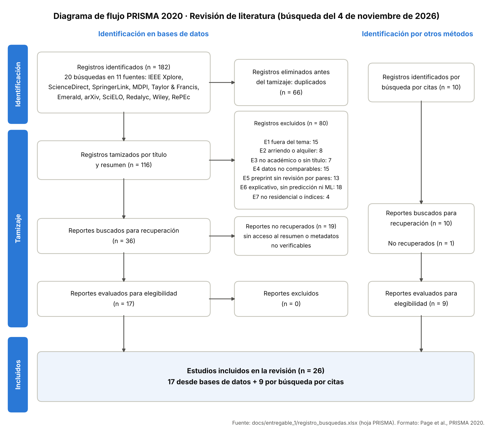

# 2. Revisión de literatura: protocolo y ejecución de la búsqueda sistemática

**Tarjeta:** T09 · **Responsable:** Juan Miguel León Gómez (Reporting Lead) · **Revisa:** Brandon Eduardo Tobar Sánchez
**Fecha de ejecución de la búsqueda:** 4 de noviembre de 2026
**Registro completo:** [`registro_busquedas.xlsx`](registro_busquedas.xlsx). Hojas: protocolo, PRISMA, criterios, búsquedas, registros, tamizaje e incluidos.
**Siguiente paso:** T10 (Brandon) hace la extracción completa y la síntesis sobre los estudios incluidos.

---

## 2.1 Objetivo y preguntas de revisión

Identificar las soluciones publicadas al problema de estimar el precio de venta de viviendas, tanto con modelos hedónicos como de aprendizaje automático. El fin es fundamentar el diseño metodológico del proyecto.

| Código | Pregunta de revisión |
|---|---|
| RQ1 | ¿Qué métodos de aprendizaje automático se usan para predecir precios de vivienda y cómo se comparan con la regresión hedónica? |
| RQ2 | ¿Qué estrategias de preprocesamiento e ingeniería de variables se emplean? |
| RQ3 | ¿Qué esquemas de validación y métricas de desempeño se reportan? |
| RQ4 | ¿Qué técnicas de interpretabilidad se aplican a los modelos? |

## 2.2 Fuentes de información

La búsqueda cubrió **11 fuentes académicas**:
- Editoriales con revisión por pares: IEEE Xplore, ScienceDirect (Elsevier), SpringerLink, MDPI, Taylor & Francis, Emerald y Wiley Online Library.
- Repositorios: arXiv y RePEc (IDEAS/EconPapers).
- Índices latinoamericanos: SciELO y Redalyc.

**Cómo se accedió a las fuentes:** las bases no se consultaron desde su propio buscador ni desde Scopus o Web of Science. Cada búsqueda se hizo en un motor de búsqueda web restringido al dominio de la base (operador `site:`), así que los conteos son los resultados que devolvió el motor para ese dominio, no el total de registros de la base.

Se complementó con **búsqueda por citas** (bola de nieve hacia atrás y hacia adelante) desde los estudios recuperados, en particular las réplicas del *Journal of Applied Econometrics* sobre los datos de Windsor.

## 2.3 Estrategia de búsqueda

**Procedimiento:**
- Cada cadena se ejecutó en un motor de búsqueda web con filtro por dominio (operador `site:`), una vez por base. No se usaron los buscadores internos de las bases ni sus filtros (año, tipo de documento, área).
- Se registraron los primeros resultados por relevancia (hasta 10 por búsqueda), con título, URL y posición.
- Cada cadena tiene su equivalente booleano para replicarla en Scopus o Web of Science.

| Cadena | Texto ejecutado | Equivalente booleano |
|---|---|---|
| C1 | house price prediction machine learning random forest gradient boosting XGBoost | `("house price*" OR "housing price*") AND ("machine learning" OR "random forest" OR "gradient boosting" OR XGBoost)` |
| C2 | hedonic pricing model versus machine learning house prices comparison | `hedonic AND "machine learning" AND ("house price*" OR housing) AND (compar* OR versus)` |
| C3 | automated valuation model mass appraisal machine learning residential property | `("automated valuation model*" OR AVM OR "mass appraisal") AND "machine learning" AND residential` |
| C4 | explainable machine learning SHAP house price prediction interpretability | `(explainab* OR interpretab* OR SHAP) AND "machine learning" AND ("house price*" OR "property valuation")` |
| C5 | predicción precio vivienda aprendizaje automático modelos regresión | `("precio* de vivienda" OR avalúo) AND ("aprendizaje automático" OR "machine learning" OR regresión)` |
| C6 | Windsor house prices Anglin Gencay hedonic semiparametric nonparametric estimation replication | `(Windsor OR "Anglin and Gencay") AND hedonic AND (semiparametric OR nonparametric)` |

**Matriz de búsquedas ejecutadas** (resultados registrados por búsqueda):

| ID | Cadena | Base de datos | Resultados |
|---|---|---|---|
| B01 | C1 | IEEE Xplore | 9 |
| B02 | C1 | ScienceDirect | 9 |
| B03 | C1 | SpringerLink | 9 |
| B04 | C1 | MDPI | 9 |
| B05 | C1 | arXiv | 9 |
| B06 | C2 | ScienceDirect | 9 |
| B07 | C2 | SpringerLink | 9 |
| B08 | C2 | MDPI | 9 |
| B09 | C2 | Taylor & Francis | 9 |
| B10 | C3 | ScienceDirect | 9 |
| B11 | C3 | MDPI | 9 |
| B12 | C3 | Taylor & Francis | 9 |
| B13 | C3 | Emerald | 9 |
| B14 | C4 | IEEE Xplore | 9 |
| B15 | C4 | ScienceDirect | 9 |
| B16 | C4 | MDPI | 9 |
| B17 | C5 | SciELO | 9 |
| B18 | C5 | Redalyc | 9 |
| B19 | C6 | Wiley Online Library | 10 |
| B20 | C6 | RePEc (IDEAS/EconPapers) | 10 |

## 2.4 Criterios de elegibilidad

**Inclusión:**
- **I1:** estudia la estimación o predicción del precio de inmuebles residenciales, o usa los datos de Windsor (Anglin y Gençay, 1996).
- **I2:** aplica o compara modelos de aprendizaje automático y/o hedónicos, o aporta metodología directamente aplicable (métricas, selección de variables, interpretabilidad).
- **I3:** es una publicación académica con metadatos verificables (autores, año, fuente, DOI o URL del editor).
- **I4:** está en inglés o español.

**Exclusión:**
- **E1:** Fuera del tema (no trata la valoración de vivienda).
- **E2:** Precio de arriendo o alquiler de corto plazo, no precio de venta.
- **E3:** No es un documento académico identificable (patente, perfil o registro sin título).
- **E4:** Depende de datos no comparables con el proyecto (imágenes, coordenadas, redes espaciales o fuentes múltiples).
- **E5:** Preprint sin evidencia de revisión por pares.
- **E6:** Objetivo explicativo o causal, sin componente predictivo ni de aprendizaje automático.
- **E7:** No residencial (comercial o suelo) o construcción de índices de precios.

## 2.5 Proceso de selección

1. **Eliminación de duplicados:** por título normalizado (sin tildes, mayúsculas ni signos). Además se eliminó una publicación indexada en dos idiomas.
2. **Tamizaje** por título y resumen con los criterios E1–E7.
3. **Recuperación y verificación (evaluación por resumen):** de cada registro que pasó el tamizaje se verificaron los metadatos (autores, año, revista, volumen y DOI o URL del editor) en la página del editor y se leyó el resumen. La elegibilidad se decidió con el resumen y esos metadatos; en esta etapa no se leyó el texto completo. Los registros sin acceso al resumen o con metadatos no verificables se marcaron como *no recuperados*.
4. **Búsqueda por citas** desde los estudios verificados, con el mismo procedimiento de verificación.
5. **Lectura del texto completo:** la hace T10 al llenar la matriz. Si un estudio no cumple los criterios al leerlo completo, se excluye y se actualizan los conteos.

## 2.6 Resultados (PRISMA 2020)

| Etapa | n |
|---|---|
| Registros identificados en bases de datos | **182** |
| Registros identificados por búsqueda por citas | **10** |
| Duplicados eliminados antes del tamizaje | **66** |
| Registros tamizados (título y resumen) | **116** |
| Registros excluidos en el tamizaje | **80** |
| Reportes buscados para recuperación (bases de datos) | **36** |
| Reportes no recuperados (bases de datos) | **19** |
| Reportes evaluados para elegibilidad (bases de datos) | **17** |
| Reportes no recuperados (búsqueda por citas) | **1** |
| Reportes evaluados (búsqueda por citas) | **9** |
| Total de estudios incluidos en la revisión | **26** |

*Reportes evaluados para elegibilidad* quiere decir evaluados con el resumen y los metadatos verificados, no con el texto completo (ver 2.5).

**Composición de los 26 estudios incluidos** (1974–2025; 20 publicados desde 2015):

| Categoría | Estudios |
|---|---|
| ML vs hedónico | 9 (E05, E06, E07, E10, E13, E14, E18, E19, E21) |
| Dataset Windsor | 3 (E02, E03, E04) |
| AVM | 3 (E08, E20, E22) |
| Interpretabilidad | 3 (E11, E15, E23) |
| Metodológico | 2 (E09, E26) |
| Latinoamérica | 2 (E24, E25) |
| Fundamento teórico | 1 (E01) |
| Revisión | 1 (E12) |
| Métricas | 1 (E16) |
| Preprocesamiento | 1 (E17) |

## 2.7 Estudios incluidos

Hallazgo preliminar tomado del resumen y los metadatos. La matriz con todas las columnas (datos, métodos, validación, métricas, resultados y relevancia) está en la hoja *Incluidos* del registro y la completa T10.

| ID | Estudio | Fuente | Datos | Hallazgo preliminar | RQ |
|---|---|---|---|---|---|
| E01 | Rosen (1974) | Journal of Political Economy | Teórico | El precio de un bien diferenciado es función de sus atributos; cada atributo tiene un precio implícito. Es la base del modelo hedónico que usamos como línea base. | RQ1 |
| E02 | Anglin y Gençay (1996) | Journal of Applied Econometrics | Windsor (Canadá), 546 ventas jul–sep 1987 | El modelo semiparamétrico da predicciones medias más precisas que el paramétrico de referencia. Es el origen de nuestro dataset. | RQ1, RQ2 |
| E03 | Parmeter et al. (2007) | Journal of Applied Econometrics | Mismos datos de Windsor | Replica el modelo parcialmente lineal y reporta ventajas del enfoque no paramétrico sobre los mismos datos. | RQ1, RQ2 |
| E04 | Haupt et al. (2010) | Journal of Applied Econometrics | Mismos datos canadienses (Windsor) | Una especificación paramétrica bien elegida no tiene que rechazarse; los métodos no paramétricos aportan en cada etapa del modelado. Anticipa que el modelo lineal puede ser competitivo en este dataset. | RQ1 |
| E05 | Selim (2009) | Expert Systems with Applications | Turquía | Compara hedónico y ANN; identifica atributos clave (sistema de agua, piscina, tipo, habitaciones, tamaño, ubicación). | RQ1 |
| E06 | Antipov y Pokryshevskaya (2012) | Expert Systems with Applications | Apartamentos residenciales (Rusia) | Random Forest superó a todos los métodos comparados; CART se usa para diagnosticar dónde falla el modelo. | RQ1, RQ3 |
| E07 | Park y Bae (2015) | Expert Systems with Applications | 5.359 casas adosadas (MLS), Fairfax County, EE. UU. | RIPPER obtuvo la mejor exactitud; el problema se planteó como clasificación del precio, no como regresión. | RQ1, RQ3 |
| E08 | Kok et al. (2017) | Journal of Portfolio Management | Activos multifamiliares en EE. UU. | Error absoluto cercano al 9 %, comparable con la exactitud de los avalúos tradicionales. | RQ1 |
| E09 | Mullainathan y Spiess (2017) | Journal of Economic Perspectives | Ejemplo de predicción del valor de viviendas | El ML resuelve problemas de predicción, no de estimación de parámetros; propone cómo evaluarlo fuera de muestra. | RQ1, RQ3 |
| E10 | Čeh et al. (2018) | ISPRS International Journal of Geo-Information | 7.407 transacciones de apartamentos, Liubliana (Eslovenia), 2008–2013 | Random Forest fue mejor en R², ratio de ventas, MAPE y coeficiente de dispersión. | RQ1, RQ3 |
| E11 | Dimopoulos y Bakas (2019) | Remote Sensing | Apartamentos de Nicosia, transacciones 2008–2014 | El análisis de sensibilidad aumenta la transparencia de los modelos de valoración masiva. | RQ4 |
| E12 | Valier (2020) | Journal of Property Investment & Finance | Revisión sistemática de comparaciones sobre los mismos datos | Los modelos de ML son en general más precisos que la regresión, pero se critican por ser cajas negras y por su poca capacidad inferencial. | RQ1 |
| E13 | Truong et al. (2020) | Procedia Computer Science | Precios de vivienda en China (ciudad por confirmar en T10) | Random Forest tiene el menor error en entrenamiento pero tiende a sobreajustar; los métodos combinados generalizan mejor con mayor costo computacional. | RQ1, RQ3 |
| E14 | Ho et al. (2021) | Journal of Property Research | ≈40.000 transacciones en Hong Kong, más de 18 años | RF y GBM superan a SVM en poder predictivo; SVM sigue siendo útil por su rapidez. | RQ1, RQ3 |
| E15 | Rico-Juan y Taltavull de La Paz (2021) | Expert Systems with Applications | Precios de oferta, Alicante (España) | RF fue el más preciso (error < 2 %); el hedónico es menos preciso pero más robusto para explicar atributos. | RQ1, RQ4 |
| E16 | Steurer et al. (2021) | Journal of Property Research | Transacciones de Graz (Austria), 2015–2020 | Clasifican 48 métricas en 7 grupos y recomiendan una lista corta de 7; la mejor métrica depende del propósito. | RQ3 |
| E17 | Yalpır et al. (2021) | Land Use Policy | Sistemas de valoración masiva (Turquía) | Aplica técnicas de selección de variables y validación para valoración masiva (resultados a extraer en T10). | RQ2, RQ3 |
| E18 | Mora-Garcia et al. (2022) | Land | España, datos antes y durante la COVID-19 | Gradient Boosting (R² ≈ 0,91) y Random Forest (≈ 0,90) fueron los mejores, con diferencia pequeña entre ellos. | RQ1, RQ3 |
| E19 | Gao et al. (2022) | Land Use Policy | Gran Sídney (Australia), áreas estadísticas | Gradient Boosting y Random Forest superan al modelo hedónico en la mayoría de escenarios. | RQ1 |
| E20 | Stang et al. (2022) | Zeitschrift für Immobilienökonomie | 1,2 millones de viviendas en Alemania | XGBoost da la mejor exactitud; optimizar OLS/GAM es costoso a escala nacional. | RQ1, RQ3 |
| E21 | Bilgilioğlu y Yılmaz (2023) | Survey Review | 1.982 datos de precedentes, 68 variables (Turquía) | Compara cinco técnicas de ML para valoración masiva (resultados a extraer en T10). | RQ1, RQ2 |
| E22 | Kim y Hong (2024) | Land | 63.306 transacciones en la isla de Jeju (Corea del Sur), 2012–2021 | El ensamble apilado supera a los algoritmos individuales en varias métricas. | RQ1, RQ3 |
| E23 | Deng y Zhang (2025) | The Annals of Regional Science | Hong Kong | Un ensamble jerárquico mejora la exactitud y la XAI identifica los determinantes del precio. | RQ1, RQ4 |
| E24 | Pérez-Rave et al. (2020) | DYNA | 15.177 apartamentos en Colombia | Los ensambles (RF y bagging) tienen mayor poder predictivo; los atributos derivados del texto se relacionan con el precio. | RQ1, RQ2 |
| E25 | Rosso-Mateus et al. (2022) | Ingeniería | Ofertas en portales inmobiliarios de tres ciudades intermedias de Colombia | Random Forest fue el mejor, seguido muy de cerca por Ridge (MAPE 0,34 vs 0,35). | RQ1, RQ2 |
| E26 | Grinsztajn et al. (2022) | Advances in Neural Information Processing Systems (NeurIPS 2022) | 45 datasets tabulares de tamaño medio | Los modelos basados en árboles siguen siendo el estado del arte en datos tabulares de tamaño medio, incluso tras ajustar hiperparámetros. | RQ1 |

## 2.8 Primeras observaciones (insumo para T10)

- **Tendencia dominante:** los ensambles de árboles (Random Forest, *gradient boosting*, XGBoost, *stacking*) logran la mayor exactitud predictiva, tanto frente al modelo hedónico (E06, E10, E12, E19, E20) como frente a otros algoritmos de ML (E13, E14, E18, E22, E24).
- **Contrapeso:** sobre **nuestro mismo dataset de Windsor**, la literatura econométrica muestra que una especificación paramétrica bien elegida es competitiva (E02–E04). Esto justifica usar el modelo hedónico como línea base fuerte y comparar con pruebas estadísticas.
- **Datos tabulares de tamaño pequeño o medio:** los modelos de árboles siguen siendo el estado del arte (E26). Esto respalda priorizar ensambles y modelos regularizados sobre redes profundas.
- **Métricas:** no hay una métrica única. Conviene reportar varias (RMSE, MAE, MAPE, R²) según el propósito (E16).
- **Interpretabilidad:** es una brecha reconocida de los AVM. SHAP y el análisis de sensibilidad son las herramientas más usadas (E11, E15, E23).
- **Contexto local:** en Colombia, los estudios encontrados muestran la misma ventaja de los ensambles, con Ridge muy cerca (E24, E25).

## 2.9 Limitaciones y siguientes pasos

- **Alcance de la búsqueda:** las bases no se consultaron directamente; el motor devuelve los resultados más relevantes de cada dominio, no el universo completo. Para el paper final se replicarán las cadenas booleanas en Scopus o Web of Science con el acceso de la biblioteca UAO, y se actualizarán los conteos.
- **Reportes no recuperados (19 + 1):** se intentarán recuperar con el acceso institucional. Si cumplen los criterios, se agregan en T10.
- **Evaluación por resumen:** la elegibilidad y los hallazgos de la tabla 2.7 se basan en el resumen y los metadatos. T10 los verifica contra el texto completo y completa la matriz.

## Referencias

[1] S. Rosen, "Hedonic prices and implicit markets: Product differentiation in pure competition," *Journal of Political Economy*, vol. 82, no. 1, pp. 34–55, 1974, doi: 10.1086/260169.

[2] P. M. Anglin and R. Gençay, "Semiparametric estimation of a hedonic price function," *Journal of Applied Econometrics*, vol. 11, no. 6, pp. 633–648, 1996, doi: 10.1002/(SICI)1099-1255(199611)11:6<633::AID-JAE414>3.0.CO;2-T.

[3] C. F. Parmeter, D. J. Henderson, and S. C. Kumbhakar, "Nonparametric estimation of a hedonic price function," *Journal of Applied Econometrics*, vol. 22, no. 3, pp. 695–699, 2007, doi: 10.1002/jae.929.

[4] H. Haupt, J. Schnurbus, and R. Tschernig, "On nonparametric estimation of a hedonic price function," *Journal of Applied Econometrics*, vol. 25, no. 5, pp. 894–901, 2010, doi: 10.1002/jae.1186.

[5] H. Selim, "Determinants of house prices in Turkey: Hedonic regression versus artificial neural network," *Expert Systems with Applications*, vol. 36, no. 2, pp. 2843–2852, 2009, [Online]. Available: https://www.sciencedirect.com/science/article/abs/pii/S0957417408000596.

[6] E. A. Antipov and E. B. Pokryshevskaya, "Mass appraisal of residential apartments: An application of Random forest for valuation and a CART-based approach for model diagnostics," *Expert Systems with Applications*, vol. 39, no. 2, pp. 1772–1778, 2012, [Online]. Available: https://www.sciencedirect.com/science/article/abs/pii/S0957417411011894.

[7] B. Park and J. K. Bae, "Using machine learning algorithms for housing price prediction: The case of Fairfax County, Virginia housing data," *Expert Systems with Applications*, vol. 42, no. 6, pp. 2928–2934, 2015, doi: 10.1016/j.eswa.2014.11.040.

[8] N. Kok, E.-L. Koponen, and C. A. Martínez-Barbosa, "Big data in real estate? From manual appraisal to automated valuation," *Journal of Portfolio Management*, vol. 43, no. 6, pp. 202–211, 2017, doi: 10.3905/jpm.2017.43.6.202. [Online]. Available: https://cris.maastrichtuniversity.nl/en/publications/big-data-in-real-estate-from-manual-appraisal-to-automated-valuat/.

[9] S. Mullainathan and J. Spiess, "Machine learning: An applied econometric approach," *Journal of Economic Perspectives*, vol. 31, no. 2, pp. 87–106, 2017, doi: 10.1257/jep.31.2.87.

[10] M. Čeh, M. Kilibarda, A. Lisec, and B. Bajat, "Estimating the performance of random forest versus multiple regression for predicting prices of the apartments," *ISPRS International Journal of Geo-Information*, vol. 7, no. 5, art. 168, 2018, doi: 10.3390/ijgi7050168.

[11] T. Dimopoulos and N. P. Bakas, "Sensitivity analysis of machine learning models for the mass appraisal of real estate. Case study of residential units in Nicosia, Cyprus," *Remote Sensing*, vol. 11, no. 24, art. 3047, 2019, doi: 10.3390/rs11243047.

[12] A. Valier, "Who performs better? AVMs vs hedonic models," *Journal of Property Investment & Finance*, vol. 38, no. 3, pp. 213–225, 2020, doi: 10.1108/JPIF-12-2019-0157.

[13] Q. Truong, M. Nguyen, H. Dang, and B. Mei, "Housing price prediction via improved machine learning techniques," *Procedia Computer Science*, vol. 174, pp. 433–442, 2020, [Online]. Available: https://www.sciencedirect.com/science/article/pii/S1877050920316318.

[14] W. K. O. Ho, B.-S. Tang, and S. W. Wong, "Predicting property prices with machine learning algorithms," *Journal of Property Research*, vol. 38, no. 1, pp. 48–70, 2021, doi: 10.1080/09599916.2020.1832558.

[15] J. R. Rico-Juan and P. Taltavull de La Paz, "Machine learning with explainability or spatial hedonics tools? An analysis of the asking prices in the housing market in Alicante, Spain," *Expert Systems with Applications*, vol. 171, art. 114590, 2021, doi: 10.1016/j.eswa.2021.114590.

[16] M. Steurer, R. J. Hill, and N. Pfeifer, "Metrics for evaluating the performance of machine learning based automated valuation models," *Journal of Property Research*, vol. 38, no. 2, pp. 99–129, 2021, doi: 10.1080/09599916.2020.1858937.

[17] Ş. Yalpır, S. Şişman, A. U. Akar, and F. B. Ünel, "Feature selection applications and model validation for mass real estate valuation systems," *Land Use Policy*, vol. 108, art. 105539, 2021, doi: 10.1016/j.landusepol.2021.105539.

[18] R.-T. Mora-Garcia, M.-F. Cespedes-Lopez, and V. R. Perez-Sanchez, "Housing price prediction using machine learning algorithms in COVID-19 times," *Land*, vol. 11, no. 11, art. 2100, 2022, doi: 10.3390/land11112100. [Online]. Available: https://www.mdpi.com/2073-445X/11/11/2100.

[19] Q. Gao, V. Shi, C. Pettit, and H. Han, "Property valuation using machine learning algorithms on statistical areas in Greater Sydney, Australia," *Land Use Policy*, vol. 123, art. 106409, 2022, doi: 10.1016/j.landusepol.2022.106409.

[20] M. Stang, B. Krämer, C. Nagl, and W. Schäfers, "From human business to machine learning—methods for automating real estate appraisals and their practical implications," *Zeitschrift für Immobilienökonomie*, vol. 9, no. 2, pp. 81–108, 2022, doi: 10.1365/s41056-022-00063-1.

[21] S. S. Bilgilioğlu and H. M. Yılmaz, "Comparison of different machine learning models for mass appraisal of real estate," *Survey Review*, vol. 55, no. 388, pp. 32–43, 2023, doi: 10.1080/00396265.2021.1996799.

[22] W. Kim and J. Hong, "Stacked ensemble model for the automatic valuation of residential properties in South Korea: A case study on Jeju Island," *Land*, vol. 13, no. 9, art. 1436, 2024, doi: 10.3390/land13091436. [Online]. Available: https://www.mdpi.com/2073-445X/13/9/1436.

[23] L. Deng and X. Zhang, "Boosting the accuracy of property valuation with ensemble learning and explainable artificial intelligence: The case of Hong Kong," *The Annals of Regional Science*, vol. 74, no. 1, art. 32, 2025, doi: 10.1007/s00168-025-01365-7.

[24] J. I. Pérez-Rave, F. González-Echavarría, and J. C. Correa-Morales, "Modeling of apartment prices in a Colombian context from a machine learning approach with stable-important attributes," *DYNA*, vol. 87, no. 212, pp. 63–72, 2020, doi: 10.15446/dyna.v87n212.80202.

[25] A. E. Rosso-Mateus, Y. M. Montilla-Montilla, and S. C. Garzón-Martínez, "Metodología para obtención y análisis de datos inmobiliarios usando fuentes alternativas: estudio de caso en tres ciudades intermedias de Colombia," *Ingeniería*, vol. 27, no. 3, art. e17952, 2022, doi: 10.14483/23448393.17952.

[26] L. Grinsztajn, E. Oyallon, and G. Varoquaux, "Why do tree-based models still outperform deep learning on typical tabular data?," *Advances in Neural Information Processing Systems (NeurIPS 2022)*, Datasets and Benchmarks Track, 2022, [Online]. Available: https://papers.nips.cc/paper_files/paper/2022/file/0378c7692da36807bdec87ab043cdadc-Paper-Datasets_and_Benchmarks.pdf.

[27] M. J. Page et al., "The PRISMA 2020 statement: An updated guideline for reporting systematic reviews," *BMJ*, vol. 372, art. n71, 2021, doi: 10.1136/bmj.n71.
